<div align="center">

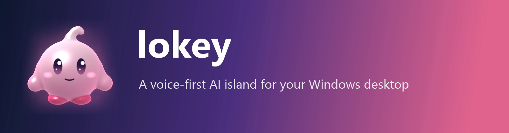

<br>

[](https://github.com/eashuu/lokey/releases)
[](https://github.com/eashuu/lokey/releases)
[](LICENSE)
[](#install)
[](https://github.com/eashuu/lokey/actions)

[](https://www.electronjs.org)
[](https://react.dev)
[](https://www.typescriptlang.org)
[](https://dotnet.microsoft.com)
[](#spirit)
[](CONTRIBUTING.md)
[](https://github.com/eashuu/lokey/stargazers)

**[Install](#install)** &nbsp;·&nbsp; **[Features](#features)** &nbsp;·&nbsp; **[Voice](#voice)** &nbsp;·&nbsp; **[Spirit](#spirit)** &nbsp;·&nbsp; **[Shortcuts](#shortcuts)** &nbsp;·&nbsp; **[Build](#build)** &nbsp;·&nbsp; **[Architecture](#architecture)** &nbsp;·&nbsp; **[Roadmap](#roadmap)**

<br>

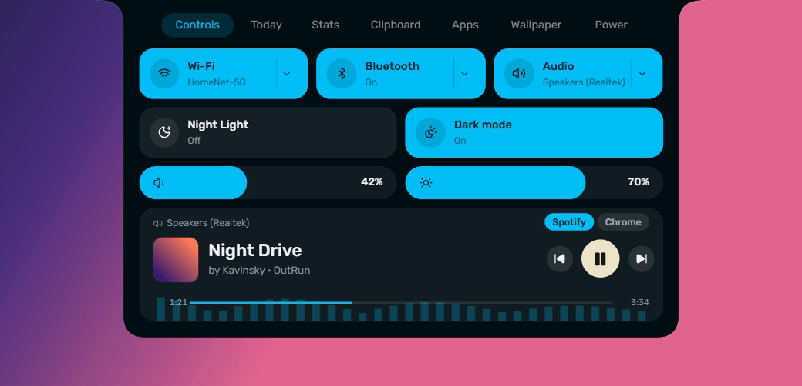

</div>

<br>

## What is lokey?

**lokey** turns the top edge of your screen into a small, living control surface. A thin bar sits in the middle of the top edge. Hover it, scroll on it or press a hotkey and it **morphs into a dashboard**: media, volume, Wi-Fi, Bluetooth, clipboard history, an app launcher, system stats, a calendar and a focus timer, all in one place and all themed from your wallpaper.

It is also a **voice assistant**. Hold a key and talk: lokey opens apps and sites, searches, schedules things for later, dictates cleaned-up text into any text field, and answers questions about whatever you circle on screen. Your assistant has a face: a round, bouncy 3D **spirit** that listens, thinks, talks, jumps, sits down and falls asleep.

> [!NOTE]
> lokey is a young open-source project (working name, version 0.1). The island and its tabs are daily-driver quality; the voice features need your own free Google AI Studio key and are still being hardened. See [Status](#status) for what is and is not verified.

<br>

<a id="features"></a>

## ✨ Features

| | Feature | What it does |
|:--:|---|---|
| 🏝️ | **Morphing island** | One animated shape grows from a thin bar into a menu, 11 sizes in all, with eased morphs and no layout jumps. Opens on hover, scroll, click or hotkey. |
| 🎛️ | **Controls** | Wi-Fi, Bluetooth, audio output, Night Light, dark mode, volume, brightness and a media card with seek, art and a live visualiser. |
| 📶 | **In-app flyouts** | Scan and join Wi-Fi networks, pair and connect Bluetooth devices, switch the default audio device without leaving the island. |
| 🎵 | **Music island** | Scroll once for a compact player for whatever is playing (Spotify, browsers, anything with Windows media controls). |
| 📋 | **Clipboard history** | Text, links and images with search, filters, pinning, multi-select, keyboard control and a full-content preview. Stored encrypted. |
| 🚀 | **Launcher** | Search installed apps, Store apps, games and indexed files; recent searches; per-app star. |
| 🗓️ | **Today** | Clock, week calendar, weather, a focus timer and a quick to-do list. |
| 📊 | **Stats** | CPU, GPU, RAM, disk, network, top apps by memory and a speed test. |
| 🖼️ | **Wallpaper** | A skewed carousel of your wallpapers; picking one grows it from your click as a circle. |
| 🎨 | **Themes** | Dark, light or follow Windows, with the accent and panel tint derived from your wallpaper. |
| 🎙️ | **Voice assistant** | Push-to-talk conversation over Gemini Live with tools, a scheduler and memory. |
| ⌨️ | **Dictation** | Hold a key in any text field, talk badly, get a clean sentence typed in. |
| ⭕ | **Circle to ask** | Draw a loop around anything on screen and ask about it out loud. |
| 🫧 | **The spirit** | A 3D character with 35+ actions and states, 14 emote reactions, 10 skins and eye contact. |
| ⚙️ | **Everything configurable** | Per-tab global hotkeys, trigger mode, size, animation speed, skins, personalities. |

<br>

<a id="screenshots"></a>

## 🖼️ Screenshots

The island adapts to its content. Dark theme on a dark wallpaper:

<table>
  <tr>
    <td width="50%">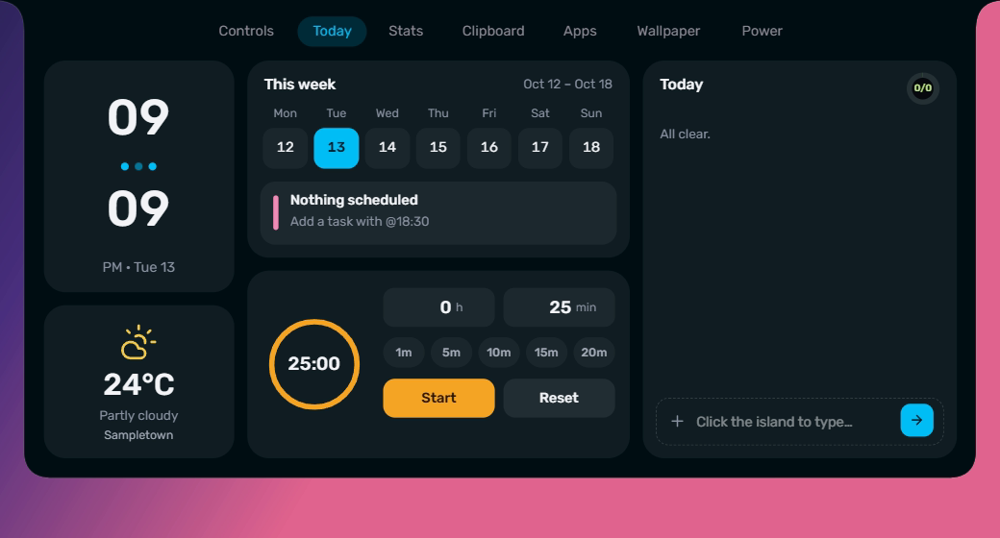<br><sub><b>Today</b>: clock, week, weather, focus timer, to-do</sub></td>
    <td width="50%">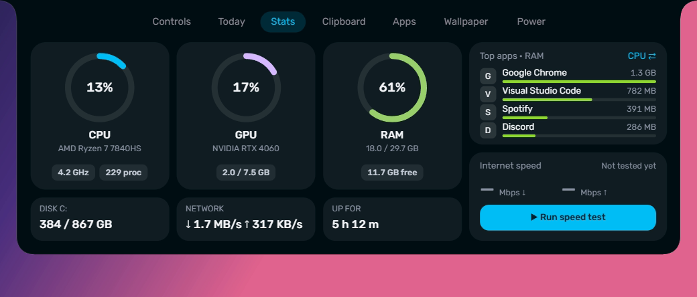<br><sub><b>Stats</b>: live CPU, GPU and memory gauges</sub></td>
  </tr>
  <tr>
    <td>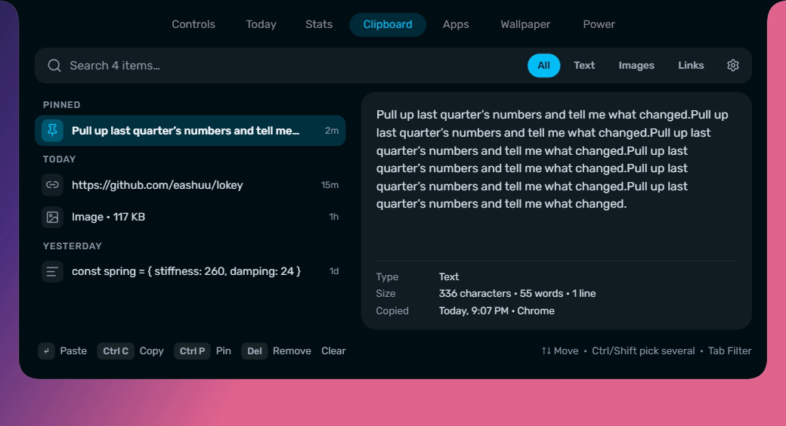<br><sub><b>Clipboard</b>: history, preview and keyboard hints</sub></td>
    <td>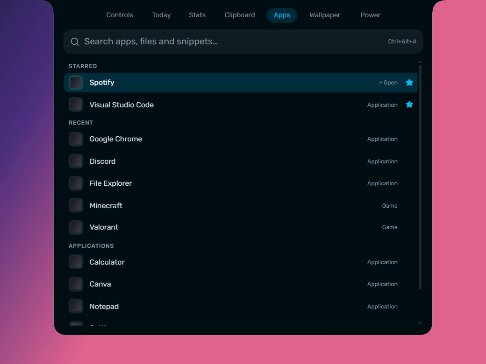<br><sub><b>Apps</b>: launcher with starred and recent apps</sub></td>
  </tr>
  <tr>
    <td>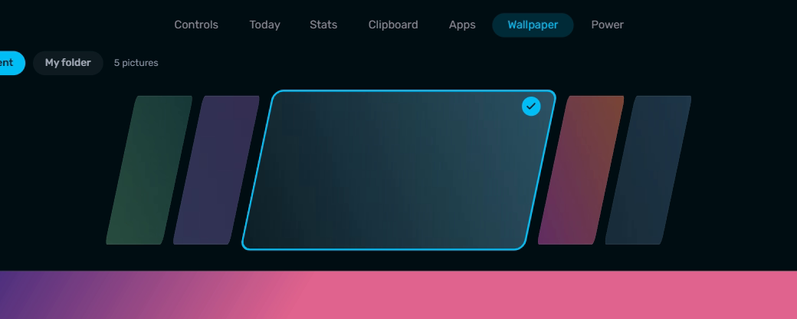<br><sub><b>Wallpaper</b>: carousel with a circle-reveal apply</sub></td>
    <td>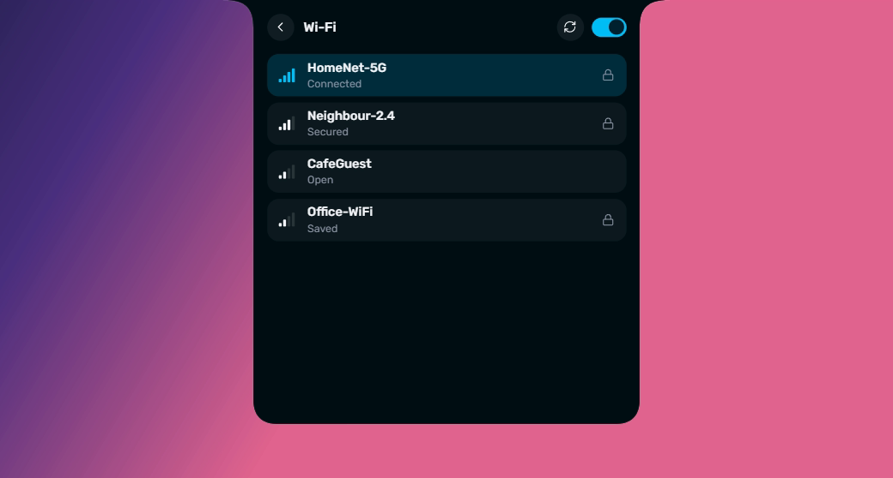<br><sub><b>Wi-Fi</b>: scan and join without opening Settings</sub></td>
  </tr>
</table>

### Light theme, same island

<table>
  <tr>
    <td width="50%">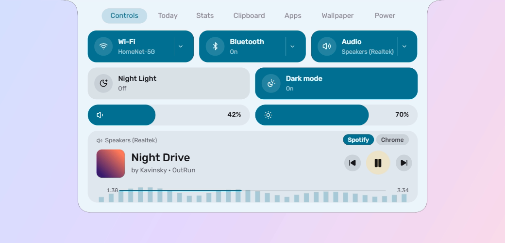</td>
    <td width="50%">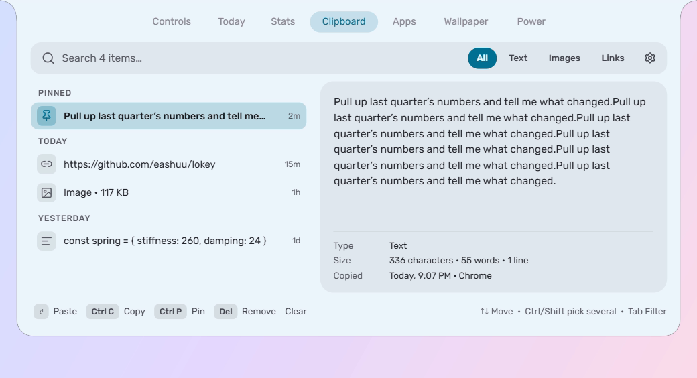</td>
  </tr>
</table>

### From a thin bar to a full panel

<div align="center">
  
  &nbsp;&nbsp;
  
  <br>
  <sub>Asleep (left) and awake (right): hover the bar and the spirit says hello.</sub>
</div>

<br>

<a id="voice"></a>

## 🎙️ Voice assistant

Everything below needs a **free Google AI Studio key** (paste it in *Settings → Voice*). It is stored encrypted on your PC and only ever sent to Google.

| Feature | How | What you see |
|---|---|---|
| **Talk** | Hold <kbd>Ctrl</kbd>+<kbd>Alt</kbd>+<kbd>V</kbd>, speak, release | The island wakes, your words stream into a pill at the bottom of the screen, the reply follows. The spirit listens, thinks and talks. |
| **Dictation** | Hold <kbd>Ctrl</kbd>+<kbd>Win</kbd> in any text field | A pill with live bars sits on the field, your raw speech streams into a bubble, then rewrites itself into the clean sentence and is typed in. Password fields are refused. |
| **Circle to ask** | Hold <kbd>Ctrl</kbd>+<kbd>Shift</kbd> briefly, draw a loop, ask | A glowing loop follows your pointer; the model gets the whole screen and a zoomed crop of what you circled. |

<table>
  <tr>
    <td width="33%">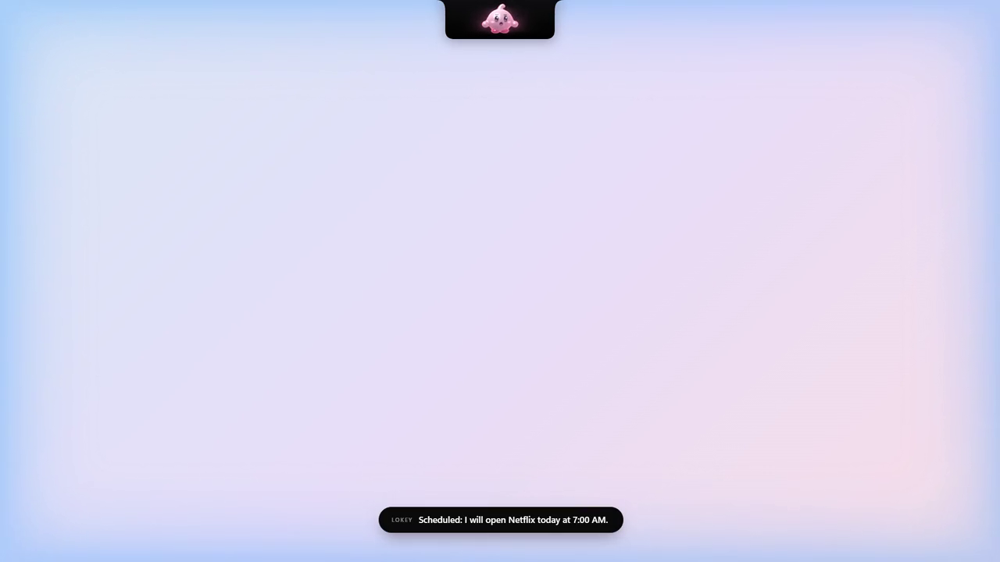<br><sub><b>"Open VS Code, then open Netflix an hour later."</b> It acts now and schedules the rest.</sub></td>
    <td width="33%">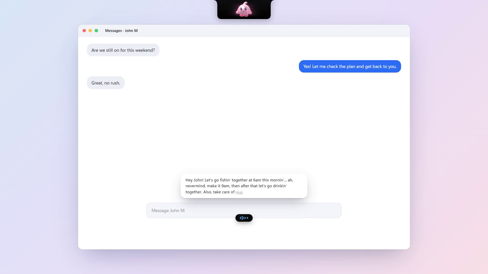<br><sub><b>Dictation</b> rewrites false starts and corrections before typing.</sub></td>
    <td width="33%">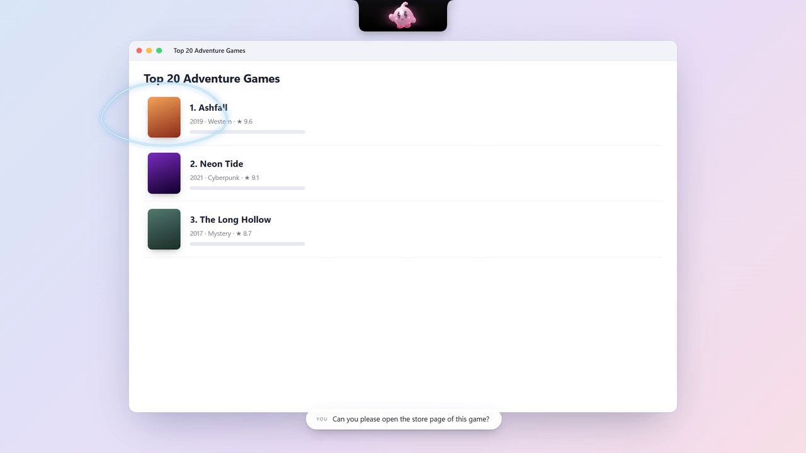<br><sub><b>Circle to ask</b>: "open the store page of this game".</sub></td>
  </tr>
</table>

<sub>These three frames come from lokey's built-in scripted demos (`lokey --demo schedule | dictation | lasso`): no microphone, no network, fake text.</sub>

**What the assistant can do** (all of it visible and reversible, nothing destructive): open apps and sites, search the web or a specific site, schedule actions for a time or delay (they survive restarts and appear on the *Desk* page), control media, volume and brightness, and remember or forget facts about you (the *Bond* page lists and edits them).

<br>

<a id="spirit"></a>

## 🫧 The spirit

The island's face is a 3D character drawn by a small WebGL2 raymarcher: no models, no textures, no dependencies. A spring-driven rig, a behaviour brain and 14 floating emote reactions make it feel alive: it looks at your pointer, blinks, fidgets, sits down when you are away, and lies down to sleep.

<div align="center">
  
  <br><sub>Skins: Puff, Bloom, Sunny, Minty, Sky and the original Droplet (more water-drop skins in Loadout).</sub>
</div>

<br>

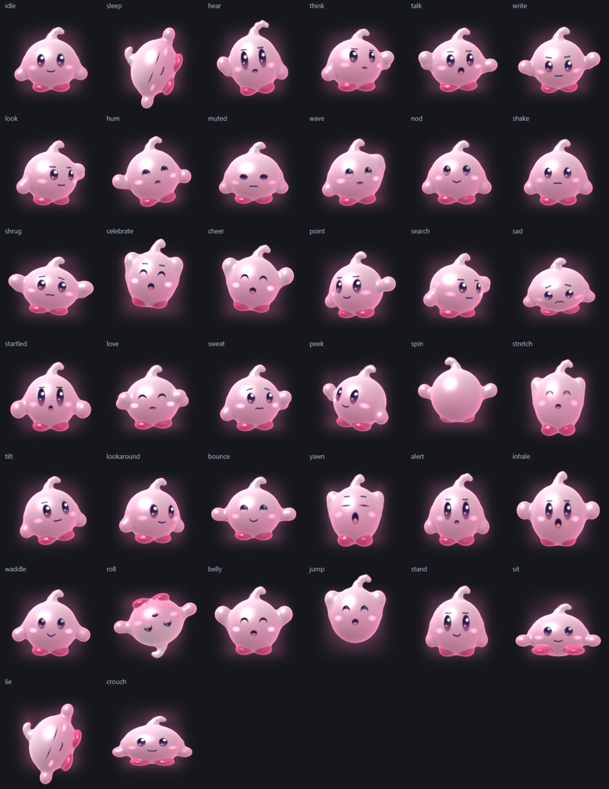

<sub>Every state and action, rendered by `lokey --lab`: idle, asleep, listening, thinking, talking, writing, looking, humming, wave, nod, shrug, celebrate, cheer, point, search, sad, startled, love, nervous, peek, spin, stretch, curious, look around, bounce, yawn, alert, inhale, waddle, roll, belly bounce, jump, stand tall, sit, lie down and crouch. Open *Open lokey → Soul* to preview them all.</sub>

<br>

<a id="install"></a>

## 📥 Install

### Option 1: download the app (recommended)

1. Open the **[Releases page](https://github.com/eashuu/lokey/releases/latest)** and download `Lokey-<version>-win-x64.zip`.
2. Unzip it anywhere (no installer, no admin rights, nothing is written outside your user folders).
3. Run **`Lokey.exe`**. A tray icon appears and the thin bar shows at the top of your screen.

| Requirement | |
|---|---|
| OS | Windows 10 (2004 or newer) or Windows 11, 64-bit |
| Size | about 450 MB unpacked (self-contained: Electron and the .NET runtime are bundled) |
| Optional | A free [Google AI Studio key](https://aistudio.google.com/apikey) for voice, dictation and circle to ask |

> [!TIP]
> The exe is **not code-signed**, so Windows SmartScreen may warn on first run: choose *More info → Run anyway*. You can verify the download against the checksum on the release page, or build it yourself below.

**First run checklist**

- Hover the bar at the top centre, or press <kbd>Ctrl</kbd>+<kbd>Alt</kbd>+<kbd>Space</kbd>.
- Right-click the tray icon → *Settings* to change the trigger, size, theme and shortcuts.
- For voice: *Settings → Voice*, paste your key, press *Save*, then hold <kbd>Ctrl</kbd>+<kbd>Alt</kbd>+<kbd>V</kbd> and talk.
- Where things live: settings and logs in `%LocalAppData%\Lokey` (delete that folder to reset everything).

### Option 2: build it yourself

See [Build from source](#build). It takes about five minutes.

<br>

<a id="shortcuts"></a>

## ⌨️ Keyboard shortcuts

Every shortcut can be changed (or cleared) in *Settings → Shortcuts*, which also tells you when Windows or another app already owns a combination.

| Action | Default | Notes |
|---|---|---|
| Open or close the island | <kbd>Ctrl</kbd>+<kbd>Alt</kbd>+<kbd>Space</kbd> | Global |
| Open the Apps tab | <kbd>Ctrl</kbd>+<kbd>Alt</kbd>+<kbd>A</kbd> | Press again to close; every tab can have its own |
| Open the Clipboard tab | <kbd>Ctrl</kbd>+<kbd>Alt</kbd>+<kbd>C</kbd> | |
| Talk to the assistant | hold <kbd>Ctrl</kbd>+<kbd>Alt</kbd>+<kbd>V</kbd> | Release to send |
| Dictation | hold <kbd>Ctrl</kbd>+<kbd>Win</kbd> | Types into the focused field |
| Circle to ask | hold <kbd>Ctrl</kbd>+<kbd>Shift</kbd> | A quick tap is ignored |
| Close the island | <kbd>Esc</kbd> | |

In the island: scroll down on the bar for the music island, scroll again for the menu; <kbd>↑</kbd><kbd>↓</kbd> move in lists, <kbd>Enter</kbd> acts, <kbd>Tab</kbd> cycles clipboard filters.

<br>

<a id="build"></a>

## 🛠️ Build from source

**Prerequisites**

| Tool | Version | Why |
|---|---|---|
| [Node.js](https://nodejs.org) | 22 or newer | build tooling |
| [pnpm](https://pnpm.io/installation) | 11 | package manager (`npm i -g pnpm`) |
| [.NET SDK](https://dotnet.microsoft.com/download/dotnet/8.0) | 8.0 | the native sidecar |
| Windows | 10 / 11, 64-bit | the sidecar uses Windows APIs |
| ffmpeg *(optional)* | any | only to regenerate the README art |

```powershell
git clone https://github.com/eashuu/lokey.git
cd lokey
pnpm run bootstrap  # installs the app's dependencies and builds the sidecar (about 2 minutes)
pnpm dev            # runs the app with hot reload
```

| Command (from the repo root) | What it does |
|---|---|
| `pnpm dev` | Start the app in development mode (renderer hot reload) |
| `pnpm build` | Production build of the app into `app/out` |
| `pnpm typecheck` | TypeScript check of the whole app |
| `pnpm sidecar` | Build the .NET sidecar (Release) |
| `pnpm package` | Build everything and assemble `app/release/Lokey/Lokey.exe` |
| `pnpm verify` | Typecheck, build the app and build the sidecar (what CI runs) |

**Quality tools** (none of them touch your real mouse, keyboard or focus):

| Mode | Command | Purpose |
|---|---|---|
| Self-check | `Lokey.exe --selfcheck` | Scheduler and tool-parsing checks |
| Sidecar self-test | `Lokey.Host.exe --selftest` | Calls every read-only native method once |
| Bench | `Lokey.exe --bench <dir>` | Frame times, CPU and memory plus screenshots of every tab |
| UI test | `Lokey.exe --uitest <dir>` | Injected-event test of hover, scroll and clicks (web contents only) |
| Lab | `Lokey.exe --lab <dir>` | Renders the spirit's pose sheet and other QA pages offscreen |
| Demos | `Lokey.exe --demo schedule\|dictation\|lasso` | Replays the voice scenarios with scripted text |

More in **[docs/DEVELOPMENT.md](docs/DEVELOPMENT.md)** and **[docs/TESTING.md](docs/TESTING.md)**.

<br>

<a id="architecture"></a>

## 🧱 Architecture

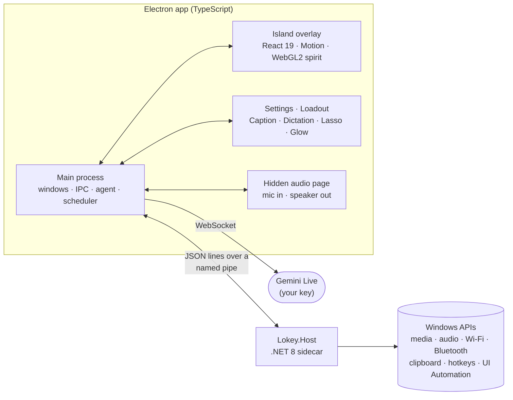

| Layer | Tech | Responsibility |
|---|---|---|
| **Renderer** | React 19, Motion, zustand, Tailwind v4, WebGL2 | The island shape (one SVG path from five animated numbers), tabs, the 3D spirit |
| **Main process** | Electron 44, TypeScript | Overlay window shaped with `setShape`, tray, settings, voice agent, scheduler, tools |
| **Sidecar** | .NET 8, NAudio, WinRT, UI Automation | Everything that needs native Windows APIs, behind a typed JSON protocol |
| **Protocol** | `app/src/shared/protocol.ts` | One TypeScript file that both sides are checked against |

```text
lokey/
├─ app/                       Electron app
│  ├─ src/main/               main process: windows, IPC, agent/ (voice, tools, scheduler, overlays)
│  ├─ src/preload/            the only bridge between pages and the main process
│  ├─ src/renderer/src/       island/ tabs/ mascot/ mainwin/ settings/ agent/ effects/ lib/ bridge/
│  ├─ src/shared/             protocol and types shared by main, renderer and tests
│  └─ scripts/                packaging and icon scripts
├─ native/Lokey.Host/         .NET 8 sidecar (Services/ for each Windows feature)
├─ assets/                    README art (logo, screenshots, sheets)
├─ docs/                      architecture, development, testing, review and roadmap
├─ scripts/                   README art generator
├─ legacy/winui-prototype/    the first, frozen WinUI 3 version (not built, kept for history)
└─ .github/                   CI, release workflow, issue and PR templates
```

Deep dive: **[docs/ARCHITECTURE.md](docs/ARCHITECTURE.md)**.

<br>

<a id="privacy"></a>

## 🔒 Privacy and security

- **No telemetry, no accounts, no cloud service of ours.** The only network traffic is what you enable: Gemini (voice features, with *your* key), weather in the Today tab (Open-Meteo, with an IP-based location lookup) and the speed test in the Stats tab (Cloudflare).
- **Your API key** is encrypted with Windows DPAPI (`safeStorage`) and only ever read in the main process. It never appears in logs.
- **Clipboard history** is encrypted per user; password-manager windows are skipped; pinned items are the one exception (stored readable, by design). Retention is configurable.
- **Voice**: the microphone is only open while you hold the key; the agent can only use a small set of reversible tools (open, search, schedule, media, volume, brightness, remember). It cannot delete files, run commands, buy or send anything.
- **Dictation** never types into password fields and refuses when focus has moved.
- Found a vulnerability? See **[SECURITY.md](SECURITY.md)**.

<br>

<a id="status"></a>

## 🚧 Status and known limits

lokey is built in the open and moves fast. Honest state of things:

| Area | State |
|---|---|
| Island, tabs, themes, clipboard, launcher, stats, wallpaper, shortcuts | ✅ Used daily |
| Wi-Fi connect, Bluetooth pairing, audio-device switching | 🧪 Implemented, needs more hardware testing |
| Voice, dictation, circle to ask | 🧪 Implemented against the Gemini Live API; needs wider real-world testing, microphone-permission and key-chord edge cases are being hardened |
| Night Light toggle | 🧪 Reads the state on supported builds; writing is unverified on recent Windows 11 |
| Multi-monitor | ⚠️ The island and overlays use the primary display |
| Memory use | ⚠️ About 600-800 MB total (most of it Chromium's GPU process); a lighter shell is on the roadmap |

A prioritised bug and risk list from a full code review lives in **[docs/REVIEW-AND-ROADMAP.md](docs/REVIEW-AND-ROADMAP.md)**.

<br>

<a id="roadmap"></a>

## 🗺️ Roadmap

- [x] Morphing island with 7 tabs, flyouts, themes and per-tab hotkeys
- [x] 3D spirit with actions, emotes, skins and postures
- [x] Voice assistant, scheduler, dictation, circle to ask
- [ ] Stability and safety pass (microphone ownership, chord hold-delay, stricter IPC)
- [ ] Permission model with on-island confirmations and an action log
- [ ] Context engine (active app, selected text, browser tab) and MCP tool servers
- [ ] Navigator: jump to windows, files and settings by voice; routines with triggers
- [ ] Real memory, optional wake word, offline speech and local models
- [ ] Installer, auto-update and a lighter runtime

Full plan: **[docs/REVIEW-AND-ROADMAP.md](docs/REVIEW-AND-ROADMAP.md)**.

<br>

<a id="contributing"></a>

## 🤝 Contributing

Issues and pull requests are very welcome: bug reports with your `main.log`, new tools for the assistant, spirit skins and actions, translations, accessibility fixes. Start with **[CONTRIBUTING.md](CONTRIBUTING.md)**; the *good first issue* label marks small starting points.

<a href="https://github.com/eashuu/lokey/graphs/contributors">
  
</a>

<br>

## 🙏 Acknowledgements

lokey stands on great open-source work: [Electron](https://www.electronjs.org), [React](https://react.dev), [Motion](https://motion.dev), [zustand](https://zustand-demo.pmnd.rs), [Tailwind CSS](https://tailwindcss.com), [Lucide](https://lucide.dev), [Material Color Utilities](https://github.com/material-foundation/material-color-utilities), [Fontsource](https://fontsource.org) (Inter, Rubik, JetBrains Mono), [NAudio](https://github.com/naudio/NAudio) and [electron-vite](https://electron-vite.org). The floating-island idea is inspired by Dynamic-Island-style launchers, and the shell look by the [Caelestia](https://github.com/caelestia-dots/shell) desktop shell for Linux. Full list in [THIRD-PARTY-NOTICES.md](THIRD-PARTY-NOTICES.md).

## 📄 License

[GPL-3.0](LICENSE) © eashuu and contributors.

<br>

<div align="center">

[](https://star-history.com/#eashuu/lokey&Date)

<sub>If lokey makes your desktop nicer, a ⭐ helps others find it.</sub>

</div>
