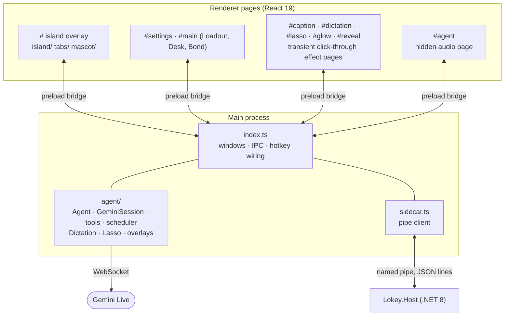

# Architecture

lokey is three cooperating parts: a **renderer** (what you see), the Electron **main process** (windows, IPC, the voice agent) and a native **sidecar** (everything that needs Windows APIs).

## The three layers

### Renderer (`app/src/renderer/src`)

One bundle, many pages chosen by the URL hash (`main.tsx`): the island itself, Settings, the Loadout window, and small transparent pages used as overlays.

- **`island/`**: `Island.tsx` animates **one SVG path** from five numbers (depth, width, corner, ramp width, ramp height). The same string is the `clip-path` of the content, so shape and content can never drift apart. `store.ts` (zustand) holds the state machine (`shape`, `view`, `mode`, `soul`, `peek`, `caption`).
- **`tabs/`**: each tab is a self-contained component laid out in design pixels; `registry.tsx` lists them. Flyouts (Wi-Fi, Bluetooth, audio) are views too.
- **`mascot/`**: the spirit. `gl.ts` is a WebGL2 raymarcher (signed-distance body, arms, feet, face painted in the body's own space); `rig.ts` is a bank of spring-damped parameters; `poses.ts` describes each action as a function of time; `brain.ts` picks what to do (state from the app, one-shot actions, blinks, glances, fidgets); `bus.ts` carries `play`/`emote`/`level`/`look` events; `Emotes.tsx` floats the reaction glyphs. If WebGL2 is unavailable the flat 2D drawing in `island/Soul2D.tsx` takes over.
- **`lib/`**: `data.ts` (one zustand store fed by sidecar events), `theme.ts` (palette from the wallpaper), `region.ts` (shapes the overlay window), `media.ts`, `inputlog.ts`.
- **`bridge/`**: the *only* way pages talk to the outside. `window.lokey` (from the preload) in Electron; a fake `mock` bridge in a plain browser and for README art.

### Main process (`app/src/main`)

- **`index.ts`** creates the island overlay (a transparent, always-on-top, non-focusable window that is *shaped* with `BrowserWindow.setShape` to exactly the island, so there is no click-through toggling and no mouse hook), the tray, IPC handlers, hotkey registration and the QA modes.
- **`sidecar.ts`** spawns `Lokey.Host.exe` and talks to it over a per-launch named pipe (current user only).
- **`effects.ts`** and **`agent/overlays.ts`** create the transient click-through windows (wallpaper reveal, edge glow, caption bar, dictation, lasso).
- **`agent/`** is the voice layer:
  `agent.ts` (turn state machine) → `session.ts` (Gemini Live WebSocket) → `tools.ts` (the allow-listed actions) → `scheduler.ts` (persisted one-timer scheduler); `dictation.ts` and `lasso.ts` are the two other hold-to-use features; `audio.ts` owns the hidden microphone/speaker page; `keystore.ts` keeps the API key encrypted.
- **`ai/`** is the model gateway and the database (round 9). `gateway.ts` is the only code that talks to a model provider: `ai.call(role, request, opts)` (also `embed`, `search`, `test`). It asks `catalog.ts` which configured providers can serve the role and the request (abilities, your order, stand-in roles), `quota.ts` whether a call fits (daily limit, rpm, background share), `health.ts` whether the model is resting (circuit breaker, demerits), then runs the attempt through an adapter (`adapters/gemini.ts`, `adapters/openai.ts`; the AI SDK is not used) and applies the rule for the error kind from `errors.ts` (retry, wait, repair, fall back). Every attempt is written by `trace.ts`. `db.ts` opens `lokey.db` (`node:sqlite`, WAL; null where unavailable, and callers then keep their JSON files), holds the shared documents (`readDoc`/`writeDoc`) and the one-time `migrateLegacy`. `chaos.ts` is the scripted fault provider for `selfcheck.ts`. `scripts/check-gateway.mjs` fails if any other file names a provider host, builds an adapter or hard-codes a model id; there is no exception any more.
  `ai/live/` is the Gemini Live voice socket: `session.ts` (one raw WebSocket; close codes classified by `classifyClose`), `supervisor.ts` (resume handle then fresh, goAway swap between turns, stall detection, metering and the circuit breaker under the id `live` through the gateway, `degraded` when Live is unusable), `surface.ts` (the 16-tool voice list and the per-turn time/program note) and `selfcheck.ts` (a mock WebSocket server). `agent/agent.ts` asks the supervisor for a session and, when it is degraded, answers through `ai.call` as text (basic voice).
  `ai/guard/` is the guardrail layer (round 9, R4) between the model and the tools. `agent/tools.ts` `execute()` is the one door: `classify()` says what a call is worth on its own, then `policy.ts` (`Guard.check`) can only make it stricter: kill switch and halt, taint flow and the Rule of Two (`taint.ts`: what untrusted content was read and which destinations it contained), hourly caps, anomaly flags, strikes (`strikes.ts`), typed cards; `takeover.ts` recognises login/payment windows; `ingress.ts` fences untrusted text (`<untrusted>` tags, datamarking) and holds the null Prompt Guard interface; `audit.ts` is the hash-chained log in `lokey.db`. `brain/guardEval.ts` + `app/evals/injection/cases.json` replay injected content against the real loop, gateway and `execute()` with a mock model and stubbed tools.
  `ai/runtime/` is the durable job runtime (R5): `journal.ts` (runs and steps in `lokey.db`, idempotency keys, resume), `verify.ts` (post-conditions), `compact.ts` (result stubs and folding), `schema.ts` (structured outputs, used by `gateway.callJson`), `plan.ts` (plan-then-execute with a quarantined extraction). `brain/loop.ts` writes to the journal and can `resume`; `brain/tasks.ts` lists interrupted runs and continues or discards them. Offline mode lives in the gateway: providers on localhost/LAN are local; when all remote models fail on the network the gateway uses only local ones, hides web tools (`visibleTools`) and polls for the network to return.
  `ai/memory/` is memory v2 (R6): `sqlstore.ts` keeps the engine's working copy (`brain/memory/store.ts`) in real tables of `lokey.db`, writes back only changed rows, migrates the older JSON document, and builds a temporary in-memory FTS5 index for BM25 ranking; `vault.ts` seals row content with AES-256-GCM under a key Windows protects (DPAPI); `mcpServer.ts` is the opt-in read-only MCP server (127.0.0.1, bearer token); `bench.ts` is `--memcheck`. In `brain/memory/`: facts are bi-temporal rows with trust and origin, `learn.ts` does one-call ADD/UPDATE/DELETE/NOOP and sends everything learned after outside content to quarantine, and `index.ts` (`Memory`) adds quarantine review, the core block and its proposals, consolidation and per-app plans. `store.live()` is the only door retrieval uses, and it never returns a quarantined fact.
  Computer use v2 (R7): the sidecar's `Services/Uia.cs` lists the numbered interactive elements of the window in front (`ui.tree`) and acts on one by number through UI Automation patterns (`ui.act`); the pure compacting step also runs on a recorded fixture (`Lokey.Host.exe --uia-fixture`, used by CI). `brain/uia.ts` formats the list for the model and re-finds elements between the actions of a speculative batch; `brain/operator.ts` runs the loop (screenshot + element list -> up to 3 actions per answer -> takeover/watch guard) through the `ground` role. Evals (R8): `brain/roleEval.ts` scores a model per role from `app/evals/roles`; the gateway's admission gate (`isAdmitted`) keeps a model you add out of main and screen until it passes; `app/evals/samples` and `private` feed `--eval`.

### Sidecar (`native/Lokey.Host`)

A headless .NET 8 program. `Pipe/Server.cs` accepts one client and `Pipe/Dispatcher.cs` routes `{id, method, params}` requests to the services (requests with the same method prefix run in order, different prefixes never block each other). `Services/` has one file per feature: `Media` (SMTC), `Audio` (NAudio + default-device switching), `Wifi`, `Bluetooth`, `Clipboard` (history store, DPAPI blobs, paste), `Apps`, `Wallpaper`, `Desktops`, `Foreground` (fullscreen detection), `Hotkeys` (registered hotkeys and the low-level keyboard hook for hold chords), `TextInput` (UI Automation focus rectangle, Unicode typing), `Stats`, `Status`, `NightLight`, `SystemControls`, `Visualiser`.

## The protocol

`app/src/shared/protocol.ts` is the contract: `Methods` (request → result) and `Events` (sidecar → app). Both the TypeScript main process and the C# `Args.*` calls follow it; adding a native feature means adding the method there first. Wire format: one JSON object per line, camelCase, nulls kept as `null`.

## Windows and overlays

| Window | Created by | Notes |
|---|---|---|
| Island overlay | `index.ts` | 1200×760, shaped to the island, `screen-saver` level, never focusable unless a text field pins it |
| Settings, Loadout | `windows.ts` | Normal windows with Mica |
| Caption bar | `agent/overlays.ts` | Click-through, bottom centre, speech pills |
| Dictation | `agent/overlays.ts` | Click-through, display-sized; pill and bubble placed at the focused field |
| Lasso | `agent/overlays.ts` | Click-through, display-sized canvas for the stroke |
| Glow, wallpaper reveal | `effects.ts` | Click-through, display-sized, torn down when done |
| Audio page | `agent/audio.ts` | Hidden; created on first use, destroyed after a minute idle |

## A voice turn, end to end

1. The sidecar's keyboard hook sees the hold chord and emits `hotkey.down`.
2. `Agent.begin()` opens the mic in the audio page, connects (or reuses) a `GeminiSession` and streams 16 kHz PCM.
3. Input transcription streams back and becomes the "YOU" pill; the island wakes and the spirit listens.
4. On release the agent sends `audioStreamEnd`; the spirit thinks (edge glow on).
5. The model answers with audio (played in the audio page, lip-sync from its level) and/or tool calls. `tools.ts` runs them and returns results; the caption shows what was done.
6. `turnComplete` → the spirit celebrates, the caption clears, the session idles out after a minute.

## MCP, watching and triage (0.6.0)

- **`main/agent/mcpWire.ts`** is the MCP wire layer: `StdioTx` and `HttpTx` (Streamable HTTP; JSON or SSE replies), `negotiate()` (modern 2026-07-28 via `server/discover` and per-request `_meta`, falling back to `initialize` for 2025-11-25 down to 2024-11-05), `x-mcp-header` mirroring, and the tool-definition pins (`PinStore`, `mcp-pins.json`). `mcp.ts` holds `McpHub` (the surface the agent uses: `decls`, `call`, `hints`, `accept`, `catalog`) and strips and flags tool output. The phone build has its own `mobile/overrides/mcp.ts` and only shares `toGeminiSchema`.
- **Trust of MCP data in `tools.ts`**: `classify()` reads annotations only for trusted connectors, forces a card for edited definitions and for send-like tool names (even in full control), and `execute()` marks a 2-minute "taint" after any external result so cards say where the request came from and cannot earn trust.
- **`agent/watch.ts` and `watchTools.ts`**: `Watcher` turns the foreground-window feed (the same `foreground.changed` event as the activity timeline) into app-open steps; `RoutineBook` stores them in `routines.json`; `routine_run` replays through `execute()`. Visible indicator: tray label, glow and captions (`watchUi`, wired in `index.ts`). Desk > Learned routines is `mainwin/LearnedRoutines.tsx` over the `lokey:routines:*` and `lokey:watch:*` channels in `trustIpc.ts`.
- **`agent/triage.ts`**: finds list-mail, list-events and save-draft tools in the connected servers by name and schema, calls them through `execute()`, summarises with a tool-less model call (`router.chat(fast)`, which now lands in the AI gateway) and writes Open loops and `triage.json` (the briefing line).
- **Sliders**: `shared/slider.ts` (pure logic, self-checked) and `renderer/lib/useSlider.ts` (the hook).
- Self-checks: `mcpSelfcheck.ts` (mock server over loopback HTTP and a stdio child) and `desktopSelfcheck.ts`.

## Asks inside the island (0.8.4)

`agent/permissions.ts` still owns every request for the person (`confirm()` / `handoff()`): the id, the queue (one card at a time, `queued` counts those behind), the timer and the answer. Two places can draw it: the island (`agent/askIsland.ts` registers an `IslandRoute`: `usable()`, `push(state)`, `shown(id)`) and the old confirm window (`#confirm`, the fallback). `confirm()` picks the island when `agent.confirmIn !== 'window'`, there is no picture on the card and `usable()` (island enabled, overlay visible and loaded, not hidden for a full-screen app, centre on some display); if the island page does not confirm within 1.5 s the same request moves to the window with its remaining time. Either way the answer is `answerConfirm(id, ok)` (the phone and Lokey Link use the same function; `req`/`done` events are unchanged). A timeout, a lost island page (`islandGone()`) or a closed window deny.

The renderer side: `shared/ask.ts` is the pure model (`askView` = the words, `askHeight`, `ARM_MS`, `keyAction`, `mayAllow`); `island/ask.ts` mirrors the state the main process sends (`lokey:ask:state`, preload `lokeyAsk`) into the island store, which gets a fifth shape `'ask'` (menu, held, awake and wake/sleep calls cannot override it); `island/AskCard.tsx` draws it inside the island clip like the menu (design pixels scaled by `NOTCH_BASE * k`, colours from the same CSS tokens, so light/dark and every edge come from the island itself). The region is the existing `lib/region.ts` path, so the card is clickable only where it is drawn, and the overlay stays non-focusable (no foreground steal). Keyboard: the global chords `agent.allowKey` / `agent.denyKey` (sidecar hotkeys 9 and 10) call `answerCurrent`; Allow from any route is ignored for `ARM_MS` after the card appears (`answerLocal`). While a card is open `sidecar.gate = inputGate` makes the sidecar refuse `input.*`, so the assistant cannot answer for you.

What was found: the separate popups that existed were the confirm card and nothing else (microphone access is auto-granted to Lokey's own hidden audio page only; there is no notification-permission or other permission popup). The asks that go through it, and so now through the island: every `classify`/guard card (including MCP tool-definition changed and send-like connector tools), "stop asking about this?" (trust), the Watch-mode step cards in the operator, the second-screen start card on the phone. New: the takeover hand-off (`tools.ts` `ctx.handoff`).

## The Flow tab (0.8.5)

The island's `agents` tab (label "Flow") shows Lokey's activity as a map. `main/agent/graph.ts` builds a `GraphSnapshot` (`shared/graph.ts`) from `TaskManager` (jobs, plus journal-interrupted ones), `Scheduler`, `openLoops()`, `ai.status()` + recent `ai.traces()` (which provider answered which role, which are resting) and `McpHub.status()`. `registerGraphIpc` (called from `ipcCore`, so the Android core gets it too) pushes `lokey:agents:graph` when the agent, scheduler, loops, voice state or a model-call trace changes, at most twice a second and only while `graphWatch` count > 0 (the tab is mounted). The renderer merges its own local to-dos, then `buildGraph()` turns the snapshot into positioned nodes/edges: placement is by region + sticky slot (`assignSlots`), so positions are stable between updates. The layout is a left-to-right bus map (redesign 0.8.5): left lane = schedules + to-dos flowing into the core, right lane = helpers, middle = core, engines (models), connectors and the activity strip. `edgeRoute()` makes orthogonal stub/spine/trunk routes and `busLines()` the deduplicated base lines, so lines cannot cross cards; `graphSelfCheck()` proves no overlaps, no crossings, determinism and sticky slots for every possible slot. The feed gained only optional fields: `events` (recent things, merged with `deriveEvents()` from jobs), `reroutes` (a model failed and another answered the same role within 90 s, derived from traces), job `until`/`waitKind` (parked). The core's state (voice + running helpers) drives CSS-only motion: transform/opacity, pulses via `offset-distance` on active routes, all off under reduced motion and paused while the window is hidden. The tab file is the only UI; shared island files only gained the `agents` entries (TabId, MENU_SIZE, TAB_WIDTH, registry).

## Never-fail AI (0.9.0)
`ai/gateway.ts` builds a chain per request (head: healthy models that have the abilities; tail: everything resting, cooling, rejected or over quota, tried once each), runs it with per-key and per-host rules and returns either an answer or an `AiError` with `until` (when to try again) and `failures[]` (which providers failed and why). Callers wait or park instead of failing: `brain/loop.ts` returns `reason: 'wait'`, `brain/tasks.ts` parks the run (journal status `parked`) and resumes it at `until` (backoff capped at 15 min, 6 h limit) from the step journal, `brain/operator.ts` waits in place, `runtime/plan.ts` returns a wait, memory learning re-queues. The voice goes down a ladder (`ai/live/ladder.ts`): Live on the first id, Live on another id (`LiveSupervisor.models()`), speech-to-text on the kept audio and a text model, text, text spoken with `speechSynthesis` in the hidden audio page (`AgentAudio.say`). `ai/modelsFeed.ts` builds `models.status` for the Models page from gateway state and implements its commands. Delegation: `brain/roles.ts` group `agents`, `do_task(role)`, `brain/cli.ts` runs the user's own Claude Code / Codex (stream-json progress, stop, timeouts); jobs of kind `cli` show in the Flow feed.

## Design notes

- **Everything that moves is `transform`/`opacity`**; nothing animates blur or box-shadow. The 3D spirit only renders while visible and releases its WebGL context when it is not.
- **No polling**: the sidecar uses WinEvent hooks, registry notifications, SMTC events and debounced emitters; the scheduler keeps one timer.
- **No synthetic input in tests**: see [DEVELOPMENT.md](DEVELOPMENT.md).
- Known weaknesses and the plan to fix them are in [REVIEW-AND-ROADMAP.md](REVIEW-AND-ROADMAP.md).
